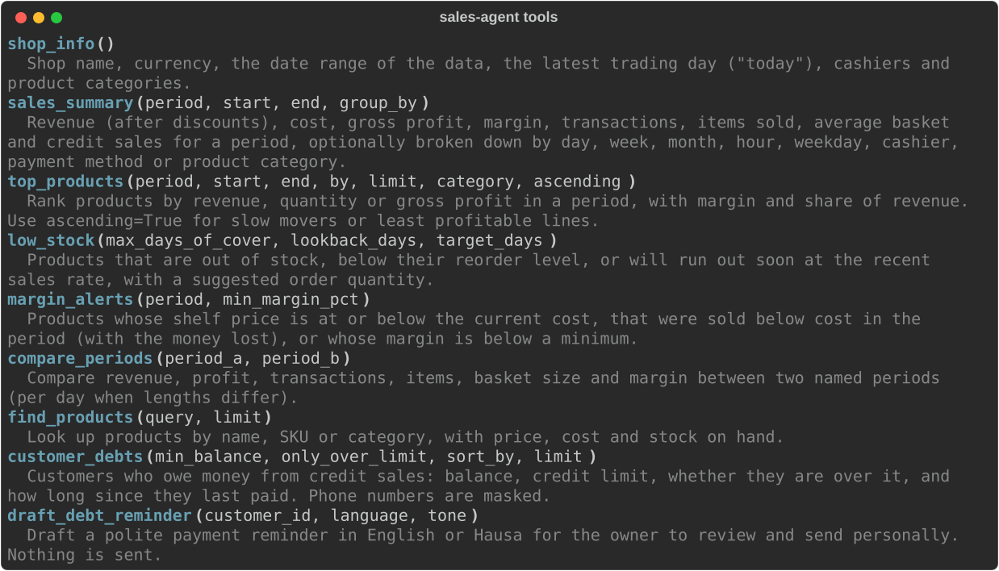
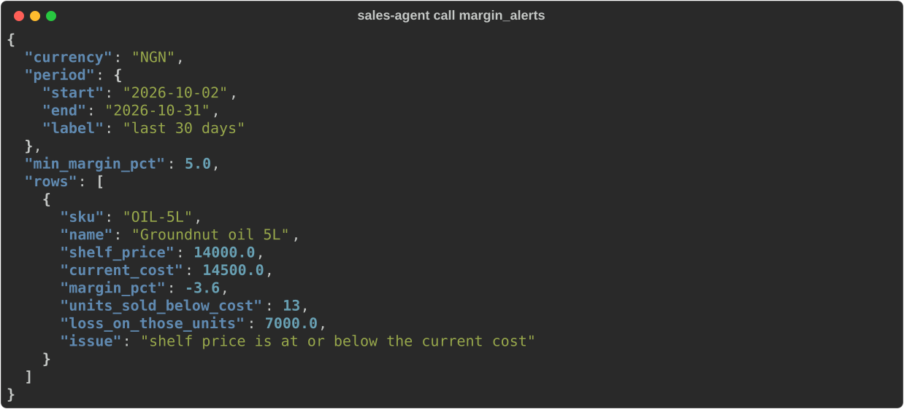
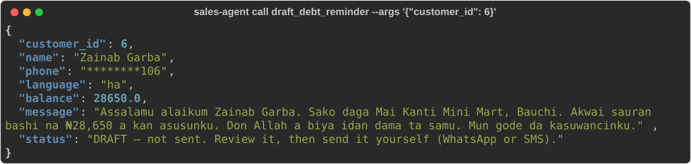
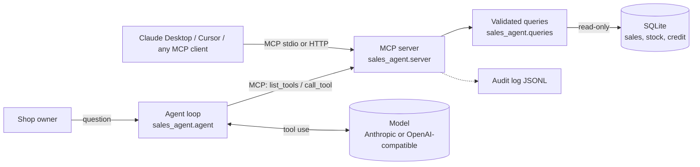

# Sales Agent MCP

**Ask your shop's data questions in plain language — through any AI assistant, safely.**

[](https://github.com/Elscorpio96/sales-agent-mcp/actions/workflows/ci.yml)


A [Model Context Protocol](https://modelcontextprotocol.io) server that gives AI assistants (Claude Desktop, Claude Code, Cursor
and any other MCP client) **read-only** tools over a retail shop's sales, stock, margins and customer credit, plus a small,
transparent agent that answers questions with those tools — using Anthropic models or any OpenAI-compatible model,
including local ones through Ollama.

> *"What has run out?"* · *"Am I selling anything at a loss?"* · *"Who owes me the most, and since when?"* ·
> *"Draft a payment reminder in Hausa for Zainab."* · *"Compare this week with last week."*



## Why this project

Most small shops in Nigeria already record every sale in a POS app, but the owner still can't simply *ask* the data a
question. Agents built on MCP can do that — if they are safe. This project focuses on the parts that make an agent
trustworthy enough to point at real business data:

| Concern | How it is handled |
|---|---|
| The model must not change or delete records | The database is opened **read-only by SQLite itself** (`mode=ro` + `query_only`), so even a tool bug cannot write. Every tool also carries MCP's `readOnlyHint` annotation. |
| No arbitrary SQL, no unbounded queries | Nine purpose-built tools with typed, validated, bounded parameters (named periods, max 366 days, `limit ≤ 50`). All SQL is parameterised. |
| Customer privacy | Phone numbers are masked (`********106`) before the model ever sees them. |
| Actions with consequences | Debt reminders are **drafts**: the server cannot send messages, and the result says so. |
| Prompt injection via data | The agent's system prompt treats tool output as data, not instructions; unknown tools and malformed arguments are refused and reported back to the model. |
| Accountability | Every tool call can be written to a JSONL **audit log** (tool, arguments, duration, outcome). |
| "Is the agent actually right?" | Tool outputs are tested against figures re-derived from raw rows, and a **golden-question eval suite** grades the live agent with [EvalSentry](https://github.com/Elscorpio96/evalsentry). |

## The tools

| Tool | Answers |
|---|---|
| `shop_info` | Shop, currency, data range, what "today" is, cashiers, categories |
| `sales_summary` | Revenue, cost, gross profit, margin, transactions, basket size, credit sales — by day, week, month, hour, weekday, cashier, payment method or category |
| `top_products` | Best (or worst) products by revenue, quantity or profit, with share of revenue |
| `low_stock` | Out of stock, below reorder level, or running out soon at the current sales rate — with a suggested order |
| `margin_alerts` | Products priced below cost or sold at a loss, and how much it cost |
| `compare_periods` | Period-over-period change (per day when the periods differ in length) |
| `find_products` | Product lookup by name, SKU or category |
| `customer_debts` | Who owes what, credit limits, who is over, days since last payment |
| `draft_debt_reminder` | A polite or firm reminder in **English or Hausa** — draft only |

The server also exposes the database schema as a resource (`shop://schema`) and a ready-made *Weekly business review*
prompt.





## Quick start

```bash
git clone https://github.com/Elscorpio96/sales-agent-mcp && cd sales-agent-mcp
python -m venv .venv && source .venv/bin/activate      # Windows: .venv\Scripts\activate
pip install -e .

sales-agent seed                    # creates data/shop.db: 120 days of generated sales for a fictional shop
sales-agent tools                   # list the tools
sales-agent call low_stock          # call a tool directly — no model, no API key
sales-agent call top_products --args '{"period": "this_month", "by": "profit", "limit": 5}'
```

### Use it from Claude Desktop (or any MCP client)

```bash
sales-agent config                  # prints the block below with the right paths for your machine
```

```json
{
  "mcpServers": {
    "sales-agent": {
      "command": "/path/to/sales-agent-mcp/.venv/bin/python",
      "args": ["-m", "sales_agent.server", "--db", "/path/to/sales-agent-mcp/data/shop.db", "--log-level", "WARNING"]
    }
  }
}
```

Paste it into Claude Desktop's `claude_desktop_config.json`, restart, and ask about the shop. For remote clients, run
`sales-agent-server --http --port 8000` to serve MCP over Streamable HTTP (bound to `127.0.0.1` by default).

### Use the bundled agent

```bash
export ANTHROPIC_API_KEY=...        # or use a local model, below
sales-agent ask "What needs my attention this week?"

# Any OpenAI-compatible model, e.g. a local one with Ollama:
sales-agent ask "Who owes me the most?" --provider openai --model llama3.1 --base-url http://localhost:11434/v1

# Full trace (every tool call, arguments, timings, tokens) as JSON, plus an audit log:
sales-agent ask "Am I losing money on anything?" --json --audit-log audit.jsonl
```

## How it works



The agent is deliberately framework-free (about 250 lines) so every step is visible: it lists the server's tools, sends
them to the model, executes the tool calls the model asks for **through MCP**, returns the results, and stops at a final
answer or a step budget. Long tool results are truncated, tool errors are passed back so the model can correct itself, and
the full trace is available as JSON.

| Module | Responsibility |
|---|---|
| `queries.py` | Business logic: periods, aggregation, stock cover, margins, credit balances, reminders. Pure functions returning pydantic models. |
| `server.py` | MCP server (Python SDK v2 `MCPServer`): tool schemas, read-only annotations, error mapping, audit log, resource and prompt. stdio or Streamable HTTP. |
| `agent.py` | Tool-use loop; Anthropic Messages API and OpenAI Chat Completions adapters over plain HTTP; a scripted model for tests. |
| `cli.py` | `seed`, `tools`, `call`, `ask`, `config`. |
| `seed.py` | Deterministic demo data generator. |

## Demo data

`sales-agent seed` generates 120 days of trading (4,700 sales, 10,400 line items) for **Mai Kanti Mini Mart**, a
fictional shop in Bauchi, with 36 everyday products in naira, three cashiers, twelve credit customers and repayments. It
is shaped to contain things worth finding — busier Fridays and month ends, two items out of stock, a supplier price rise
that left 5L groundnut oil selling below cost, and two customers over their credit limit who have never paid back. **All
of it is generated; none of it describes a real business or real people.** Point `--db` at your own SQLite file with the
same schema (`sales-agent call` + `shop://schema` show it) to use real data.

## Testing and evaluation

```bash
pip install -e ".[dev]"
pytest -q                     # 57 tests
ruff check . && mypy sales_agent   # mypy in strict mode
```

- **Query correctness:** every reported figure (revenue, profit, credit sales, group breakdowns, rankings, stock cover,
  losses, balances) is recomputed from the raw rows in plain Python and compared.
- **Safety:** writes are rejected by the database; bad periods, oversized limits and malformed arguments are refused;
  phone numbers are masked; reminders are never sent.
- **MCP:** tool listing, schemas and annotations, structured results, error mapping, audit log, resource and prompt —
  in-process **and over a real stdio subprocess**, the transport Claude Desktop uses.
- **Agent:** the tool loop, step limit, truncation, unknown tools and invalid JSON, and the exact Anthropic and OpenAI
  request/response formats (HTTP mocked).
- **Live evals:** [`evals/evalsentry.yaml`](evals/evalsentry.yaml) asks the real agent nine golden questions — tool
  choice, exact figures, a Hausa reminder, refusing to edit data, refusing to invent numbers for dates outside the data,
  and an off-topic question — graded by rules and an LLM judge, each run twice. CI runs it whenever an
  `ANTHROPIC_API_KEY` repository secret is set; `tests/test_golden_facts.py` keeps the expected facts in sync with the data.

CI runs on Python 3.11–3.13 (Linux) and 3.12 (Windows), plus a CLI smoke test over stdio.

## Status and limitations

- The agent's tests use **simulated model responses** in the providers' documented formats; no live model run is
  claimed here. Add an API key (or a local Ollama model) and run the eval suite to measure a specific model.
- Built and tested against the MCP Python SDK **v2** (`MCPServer`). It speaks the standard protocol over stdio and
  Streamable HTTP, but I have not tested every MCP client.
- Single shop, single SQLite database, read-only. Multi-shop data, authentication for the HTTP transport and write
  actions with human approval are on the roadmap.

## Roadmap

- Connector for the Ilelah Business Suite cloud database (Postgres/Supabase) behind the same tools
- OAuth for the HTTP transport; per-user tool permissions
- Human-approved actions (e.g. send a reminder via WhatsApp after the owner confirms)
- Forecasting tool (demand for the next 2 weeks) and anomaly alerts

## Licence

MIT © 2026 Walid Bello Yakubu
